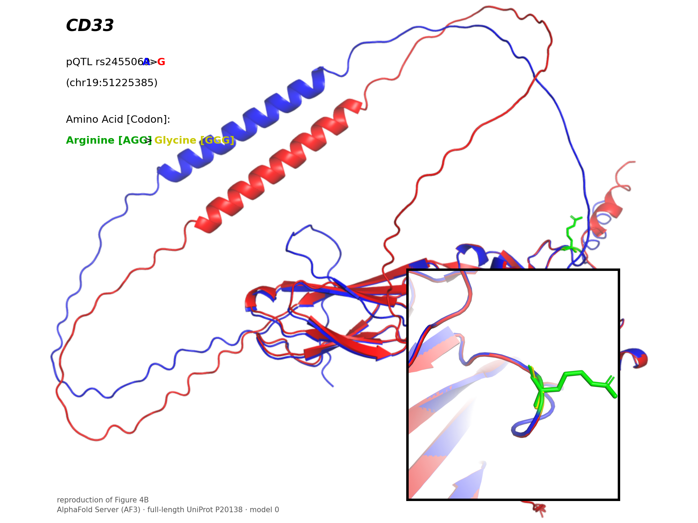
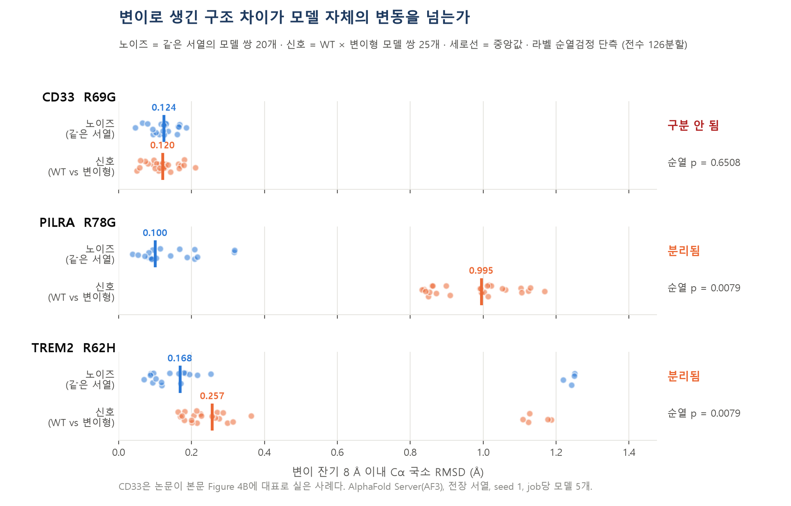

# AlphaFold3 논문 재현과 변이 감별력 검정 (BlindSpot)

알츠하이머 인과 단백질의 AlphaFold3 구조 예측(Yao et al. 2024)을 같은 조건으로 다시 실행하고, 예측 모델이 미스센스 변이를 감별하는지 음성 대조군과 라벨 순열검정으로 검정한 저장소임.

- 2인 팀 작업임. 저장소 소유자(qkrvlfg123)가 맡은 범위는 Boltz-2 결합 축의 두 번째 복합체(PILRA + NPDC1) 확장, 구조 축과 결합 축의 2×2 교차검증 매트릭스, 음성 대조군 기반 순열검정으로의 검정 재설계(Python과 JS 동일 알고리즘)임. 자세한 분담은 아래 "역할 분담" 표에 있음.
- 수치 표기: (코드)는 저장소 안의 결과 파일과 스크립트로 직접 다시 계산해 확인한 값, (기록)은 기존 README나 문서에만 있고 저장소에 계산 파일이 없는 값임.
- 원논문: Yao, M. et al. (2024) Deciphering proteins in Alzheimer's disease: A new Mendelian randomization method integrated with AlphaFold3 for 3D structure prediction. Cell Genomics 4, 100700. [10.1016/j.xgen.2024.100700](https://doi.org/10.1016/j.xgen.2024.100700)
- 데모: https://qkrvlfg123.github.io/AD-AlphaFold3-Reproduction/app/ (이 저장소 `main`의 [`app/`](app) 정적 배포본)

결과 요약

| 항목 | 내용 |
|---|---|
| 구조 축 (AlphaFold3) | 3개 단백질 중 PILRA는 음성 대조군과 구분됨. CD33은 구분되지 않음. TREM2는 지표에 따라 판정이 갈림 |
| 결합 축 (Boltz-2) | TREM2 + Aβ42, PILRA + NPDC1 두 복합체 모두 변이를 감별하지 못함 |
| 해석 | 구조 예측으로 변이 효과를 논하기 전에 모델의 변이 감별력을 먼저 검정해야 함 |

CD33은 원논문이 본문 Figure 4B에 대표로 실은 사례임.

### 역할 분담

| 구성원 | 맡은 범위 | 주요 위치 |
|---|---|---|
| qkrvlfg123 (저장소 소유자) | Boltz-2를 두 번째 복합체(PILRA + NPDC1)로 확장. 구조 축 × 결합 축 2×2 교차검증 매트릭스 구축. 유의성 검정을 음성 대조군 기반 순열검정으로 재설계(Python, JS 동일 알고리즘으로 통일) | [`src/make_boltz_npdc1_inputs.py`](src/make_boltz_npdc1_inputs.py), [`src/detectability.py`](src/detectability.py), [`src/analyze_boltz.py`](src/analyze_boltz.py)의 PILRA 축과 순열검정 부분, [`inputs/boltz/README_NPDC1.md`](inputs/boltz/README_NPDC1.md), [`app/app.js`](app/app.js)의 2×2 매트릭스와 순열검정 부분, [`docs/PROGRESS.md`](docs/PROGRESS.md), [`tests/`](tests) |
| [mimm-112](https://github.com/mimm-112) | AF3 재현, Mann-Whitney 검정, TREM2 + Aβ42 Boltz-2, BlindSpot 웹 앱, 슬라이드 | [`src/`](src)의 AF3 파이프라인, [`src/make_boltz_inputs.py`](src/make_boltz_inputs.py), [`notebooks/02_boltz_trem2_ab42.ipynb`](notebooks/02_boltz_trem2_ab42.ipynb), [`app/`](app), [`app/slides/`](app/slides) |

---

## 배경

원논문은 알츠하이머 인과 단백질의 미스센스 변이가 3D 구조를 바꾼다고 보고함. 근거는 야생형 구조 1개와 변이형 구조 1개를 겹친 그림임.

구조 예측 모델은 확률적 생성 모델이라 같은 서열을 넣어도 출력이 조금씩 달라짐. 야생형과 변이형 사이에서 관측된 구조 차이가 변이 때문인지 모델 자체의 변동인지는 구조 1쌍으로 구분할 수 없음. 이 저장소는 같은 서열에서 나온 모델들 사이의 차이를 음성 대조군으로 두고, 변이형과의 차이가 그 변동을 넘는지 검정함.

### 선행 연구와의 차이

| 구분 | 선행 연구 | 이 저장소 |
|---|---|---|
| 원논문 (Yao 2024) | WT 1개와 변이형 1개를 겹쳐 "구조가 변했다"고 기술 | 음성 대조군을 두고 통계 검정 |
| AlphaFold 한계 (Buel 2022) | AF2가 미스센스 변이에 둔감함을 지적 | 단백질별로 정량화해 판정 |
| 통계 처리 | 쌍 비교를 독립 표본처럼 검정 | 라벨 순열검정으로 쌍 비독립성 교정 |
| Boltz-2 한계 (Bret 2026) | affinity가 결합부위 변이에 둔감함을 보고 | AD 표적 2건에서 같은 경향 확인 |
| 실험 문헌 (Zhao 2018 등) | R62H가 Aβ 결합을 감소시킴 | 예측 모델이 이 변화를 감별하지 못함을 확인 |
| 실험 문헌 (Rathore 2018) | PILRA G78R이 리간드 결합을 50% 이상 감소시킴 | 예측 모델이 감별하지 못함. 글리칸 부재가 원인일 수 있음(추정) |

구조와 결합 두 축에 같은 검정 절차를 적용해, 예측 모델의 변이 감별력 자체를 재는 절차를 제시함.

### 재현 범위

원논문 파이프라인은 ① MR-SPI 통계, ② AlphaFold3 구조 예측 두 단계임. 이 저장소는 ②만 직접 실행했고 ①은 논문 결과를 인용함.

| 단계 | 이 저장소 | 사유 |
|---|---|---|
| ① MR-SPI (인과 단백질 식별) | 실행하지 않음. 논문 결과 인용 | 입력 자료가 통제접근 |
| ② AlphaFold3 (구조 예측) | 직접 실행하고 검정을 추가 | 웹서버 무료 공개 |
| ③ Boltz-2 (결합 예측) | 직접 실행. 이 저장소의 확장 | MIT 라이선스 |

MR-SPI 코드는 공개되어 있음. 실행을 막는 것은 입력 데이터의 접근 조건임.

| 필요 자원 | 공개 상태 | 제약 |
|---|---|---|
| MR-SPI R 패키지 | 공개. [GitHub MinhaoYaooo/MR-SPI](https://github.com/MinhaoYaooo/MR-SPI), [Zenodo 10.5281/zenodo.14036275](https://doi.org/10.5281/zenodo.14036275) | 없음 |
| AD GWAS 요약통계 (Jansen 2019) | [공개 다운로드](https://ctg.cncr.nl/software/summary_statistics) | 대용량 |
| UKB-PPP pGWAS 요약통계 | [Synapse syn51365301](https://www.synapse.org/Synapse:syn51365301) | 통제접근. 별도 신청과 승인 필요 |

UKB-PPP는 신청과 승인이 필요하고 규모도 커서 작업 기간 안에 확보하지 못함. 7개 인과 단백질 목록과 인과효과 방향은 이 저장소의 결과가 아니라 논문에서 가져온 전제임. 이 저장소는 MR-SPI를 구현하거나 실행하지 않았고, 위 링크는 원저자 공개 자원의 인용임.

---

## 데이터

### 대상 단백질과 변이

[`results/sequences_manifest.csv`](results/sequences_manifest.csv) 기준 (코드).

| 단백질 | UniProt | 변이 | dbSNP | 전장 길이 | Ig 도메인 구간 (길이) |
|---|---|---|---|---|---|
| CD33 | P20138 | R69G | rs2455069 | 364 aa | 19~135 (117 aa) |
| PILRA | Q9UKJ1 | R78G | rs1859788 | 303 aa | 32~150 (119 aa) |
| TREM2 | Q9NZC2 | R62H | rs143332484 | 230 aa | 19~130 (112 aa) |

- 입력 서열은 야생형과 변이형, 전장과 도메인 조합으로 12개임. FASTA는 [`inputs/seqs/`](inputs/seqs)에 있음.
- PILRA의 변이 방향: UniProt 정본(Q9UKJ1)의 78번이 이미 R이라 정상형이 G78임. 문헌 표기 G78R과 방향이 반대이므로 결합 축에서는 WT/MUT 대신 잔기 이름(G78, R78)으로 표기함.

### 저장소에 포함된 예측 결과

| 경로 | 내용 | 수량 (코드) |
|---|---|---|
| [`data/alphafold3/`](data/alphafold3) | AlphaFold Server 결과. 작업 6개(단백질 3 × 야생형, 변이형), 작업당 모델 5개, 시드 1 | 구조 30개, 신뢰도 JSON 30개, 작업 요청 JSON 6개 |
| [`data/boltz2/`](data/boltz2) | Boltz-2 TREM2 + Aβ42 결과. 대립형질 2 × 시드 3 × 모델 5 | 구조 30개, 신뢰도 JSON 30개 |
| [`results/rmsd_pairs.csv`](results/rmsd_pairs.csv) | 모델 쌍별 RMSD (도메인 전체, 변이 주변 8 Å 국소) | 135쌍 (단백질당 45쌍) |
| [`results/boltz_iptm.csv`](results/boltz_iptm.csv) | Boltz-2 신뢰도 지표 | 50행 (TREM2 30, PILRA 20) |
| [`results/confidence_summary.csv`](results/confidence_summary.csv) | AF3 모델별 pTM, pLDDT | 30행 |

- 예측 구조는 모두 60개임(AF3 30 + Boltz-2 30). MSA와 PAE 행렬은 다시 만들 수 있어 저장소에서 제외함.
- PILRA + NPDC1 복합체는 ipTM 수치만 수록했고 구조 파일(.cif)과 나머지 신뢰도 지표는 저장소에 없음. 해당 20행의 원시 Boltz-2 출력은 이 저장소에서 확인할 수 없음.
- 결합 파트너 서열: Aβ42는 APP(P05067) 672~713, NPDC1(Q9NQX5)은 세포외 도메인 35~181(147 aa)임.

---

## 방법

### 가설과 검정 설계

| 항목 | 내용 |
|---|---|
| 귀무가설 H0 | 야생형과 변이형의 예측 구조 차이는 같은 서열에서 나온 모델들 사이의 변동과 같음 |
| 대립가설 H1 | 변이형의 구조 차이가 그 변동을 초과함 |
| 음성 대조군 | 같은 서열에서 나온 모델 5개의 쌍 (변이 없음, 차이는 모델 변동뿐) |
| 처리군 | 야생형 × 변이형 구조 쌍 |
| 통계량 | median(처리군 쌍) − median(음성 대조군 쌍) |
| 검정 | 라벨 순열검정, 단측, α = 0.05. 두 축 공통 |
| 통제 변수 | 같은 도구, 같은 서열 구간, 시드 고정, 같은 샘플 수 |

- 순열 방식: 분할 수가 20,000 이하이면 전수 열거, 초과하면 고정 시드(1) 표본 20,000회임. 둘 다 결정적이라 다시 실행해도 같은 값이 나옴 ([`src/detectability.py`](src/detectability.py)).
- 조건당 모델이 5개면 전수 분할이 126개이므로 도달 가능한 최소 p는 1/126 = 0.0079임. 더 작은 p를 얻으려면 모델 수를 늘려야 함.
- α = 0.05, 국소 RMSD 반경 8 Å는 관례에 따라 정한 초기값임. 반경을 바꾼 민감도 분석은 하지 않음.
- Python 엔진과 웹 앱([`app/app.js`](app/app.js))이 같은 알고리즘과 같은 PRNG(mulberry32)를 사용함.

### 구조 축 (AlphaFold3)

- AlphaFold Server에 UniProt 전장 서열을 넣어 작업당 모델 5개를 받음.
- Ig 도메인 Cα로 정렬한 뒤, 재정렬 없이 변이 잔기 8 Å 이내 Cα의 국소 RMSD를 측정함 ([`src/rmsd_analysis.py`](src/rmsd_analysis.py), PyMOL).
- 음성 대조군은 WT-WT 10쌍과 변이형-변이형 10쌍으로 20쌍, 처리군은 WT 5 × 변이형 5로 25쌍임.

음성 대조군의 범위. AlphaFold Server 작업은 서열당 1회, 시드 1개로 실행함(`data/alphafold3/*/fold_*_job_request.json`의 `modelSeeds: ["1"]`, 코드). 구조 축의 음성 대조군 쌍은 한 작업 안에서 나온 확산 표본 5개 사이의 변동이고, 처리군 쌍은 항상 서로 다른 두 작업(야생형 작업 × 변이형 작업) 사이의 차이임. 작업 간, 시드 간 변동은 음성 대조군에 들어 있지 않아 변이 효과와 분리되지 않음. 차이가 작은 TREM2(0.09 Å)가 이 제약의 영향을 가장 크게 받음. 결합 축(Boltz-2)은 시드 2~3개로 실행해 시드 간 쌍이 음성 대조군에 들어 있음.

입력 구간 복원. 논문은 AlphaFold 방법을 STAR Methods에 기술하지 않았고 입력 구간도 명시하지 않음. 두 근거로 전장 서열이라고 판단함. (i) 논문 Fig 4B와 S5 원본에 무질서 꼬리가 있음, (ii) 전장일 때만 pTM 0.6이 재현됨.

### 결합 축 (Boltz-2)

결합 축 검정은 대조할 실험 근거가 있는 복합체에만 적용할 수 있음. "이 변이가 이 결합을 바꾼다"고 실험 문헌이 보고한 두 쌍을 고름.

| 복합체 | 실험 근거 | 파트너 유형 | 입력 구간 | 실행 |
|---|---|---|---|---|
| TREM2 + Aβ42 | R62H가 Aβ 결합을 감소시킴 (Zhao 2018, Zhong 2018) | 펩타이드 (APP 672~713) | TREM2 Ig 도메인 19~130 + Aβ42, 154 aa | 시드 3 × 모델 5, 대립형질당 15구조 |
| PILRA + NPDC1 | G78R이 NPDC1을 포함한 리간드 결합을 50% 이상 감소시킴 (Rathore 2018) | 단백질 (세포외 도메인) | PILRA 32~150 + NPDC1 35~181, 266 aa | 시드 2 × 모델 5, 대립형질당 10구조 |

- ipTM은 구조당 스칼라이므로 쌍 차이 `|ipTM_i − ipTM_j|`로 바꿔 구조 축과 같은 쌍 설계에 맞춤. 같은 대립형질 안의 쌍이 음성 대조군, 대립형질 간 쌍이 처리군임.
- Boltz-2 2.2.1을 Colab T4에서 `--use_msa_server --diffusion_samples 5`로 실행함 ([`notebooks/02_boltz_trem2_ab42.ipynb`](notebooks/02_boltz_trem2_ab42.ipynb), [`inputs/boltz/README.md`](inputs/boltz/README.md)).
- Boltz-2의 affinity head는 저분자 전용이라 사용하지 않음. 얻는 값은 결합력이 아니라 인터페이스 신뢰도(ipTM)임.
- CD33은 결합 축에서 제외함. CD33의 결합 파트너는 시알산(당)이고, 이 저장소의 결합 축은 단백질-단백질 예측 설계라 이 조합을 다루지 않음. Boltz-2 자체는 SMILES나 CCD 코드로 당과 저분자를 입력할 수 있으나 설계 범위 밖임.

### 웹 애플리케이션 (BlindSpot)

검정 절차를 브라우저에서 실행하는 정적 애플리케이션임. 서버와 빌드 과정이 없음. 화면은 홈, 분석, 구조 검증, 결합 인터페이스 검증, 리포트, 방법론 6개임. 세부 내용은 [`app/README.md`](app/README.md)에 있음.

| 기능 | 상태 | 구현 위치 |
|---|---|---|
| UniProt 조회와 잔기 대조 검증 (임의 accession) | 구현됨 | `app/app.js` |
| 변이 서열 생성, 도메인 자동 절단 | 구현됨 | `app/app.js` |
| 입력 파일 내려받기 (FASTA, AF Server JSON, Boltz YAML) | 구현됨 | `app/app.js` |
| 감별력 검정 재계산 (라벨 순열검정) | 구현됨. 원자료 CSV에서 브라우저가 계산 | `app/app.js` |
| 3D 구조 뷰어 (Mol*) | 구현됨. WebGL이 없으면 사전 렌더 이미지로 대체 | `app/app.js` |
| 결과 ZIP 업로드 후 편차 계산과 검정 (구조 축만) | 구현됨. mmCIF 파싱, Horn 중첩, 국소 RMSD | `app/analyze.js` |
| 2×2 종합 판정 매트릭스 | 구현됨. 리포트 화면(`?s=s5`) | `app/app.js` |
| 구조 예측 실행 | 구현하지 않음. GPU 필요. 사용자가 AlphaFold Server에서 실행 | 해당 없음 |

- 잔기 검증은 [`src/sequences.py`](src/sequences.py)의 `assert` 규칙을 옮긴 것임. `Q9UKJ1` + `G78R`을 입력하면 방향이 반대임을 감지하고 `R78G`를 제시함.
- 업로드 경로는 도메인 주석 대신 양쪽 모두 pLDDT 70 이상인 잔기로 정렬함(초기값). CD33 R69G를 업로드 경로로 계산하면 음성 대조군 0.194, 처리군 0.180, 비 0.93×, p 0.72로 사전 산출값과 판정이 같다고 [`app/README.md`](app/README.md)에 적혀 있음 (기록).
- `file://`로 열면 CORS 때문에 UniProt 조회가 차단되므로 HTTP 서버가 필요함.

---

## 결과

검정 수치는 `results/`의 CSV를 [`src/detectability.py`](src/detectability.py)에 넣어 다시 계산한 값임. [`tests/test_detectability.py`](tests/test_detectability.py)가 구조 축 국소 지표와 결합 축 ipTM 값을 검사하며 9개 테스트가 모두 통과함 (코드).

### 1. 논문 재현: CD33 pTM 일치

| 단백질 | 변이 | 재현 pTM (코드) | 논문 보고 pTM (기록) | 도메인 pLDDT (코드) |
|---|---|---|---|---|
| CD33 | R69G | 0.59~0.60 | 0.6 | 97.3~97.4 |
| PILRA | R78G | 0.44~0.46 | 보고 없음 | 96.9~98.2 |
| TREM2 | R62H | 0.52~0.54 | 보고 없음 | 83.1~94.6 |

논문과 직접 비교할 수 있는 값은 CD33의 pTM 하나(반올림된 0.6)뿐이고, 입력 구간도 이 값이 맞도록 고른 것임. 이 절은 같은 조건을 복원했다는 근거이며 논문 결과 전체의 재현을 뜻하지 않음.

신뢰도 상세 ([`results/slide_tables.md`](results/slide_tables.md), [`results/confidence_summary.csv`](results/confidence_summary.csv), 코드)

| 단백질 | 대립 | pTM | 전장 pLDDT | 도메인 pLDDT | 변이부위 pLDDT | 무질서 비율 |
|---|---|---|---|---|---|---|
| CD33 | WT | 0.59~0.60 | 70.4~71.6 | 97.3~97.4 | 96.7~97.1 | 0.41~0.42 |
| CD33 | R69G | 0.59~0.60 | 70.8~71.8 | 97.3 | 95.5~95.9 | 0.41~0.42 |
| PILRA | WT | 0.44~0.45 | 62.8~64.5 | 96.9~97.1 | 80.4~83.5 | 0.60~0.61 |
| PILRA | R78G | 0.44~0.46 | 62.5~64.7 | 97.9~98.2 | 97.6~97.9 | 0.60 |
| TREM2 | WT | 0.52~0.54 | 66.1~68.2 | 94.0~94.6 | 97.0~97.3 | 0.49~0.52 |
| TREM2 | R62H | 0.52~0.54 | 63.2~67.4 | 83.1~94.6 | 91.2~96.5 | 0.48~0.51 |

pTM이 0.5~0.6으로 낮은 것은 신호펩타이드, 막관통 구간, 세포질 꼬리가 무질서하기 때문임(무질서 비율 0.41~0.61). 변이가 있는 Ig 도메인의 pLDDT는 TREM2 R62H 모델 하나(83.1)를 빼면 93~98임.



PILRA와 TREM2의 같은 구도 그림은 [`figures/PILRA_R78G_paper_style.png`](figures/PILRA_R78G_paper_style.png), [`figures/TREM2_R62H_paper_style.png`](figures/TREM2_R62H_paper_style.png)에 있음.

### 2. 구조 축: 3개 중 1개는 모델 변동과 구분되지 않음

국소 지표. 변이 잔기 8 Å 이내 Cα 국소 RMSD 중앙값, 전수 열거 126분할 (코드).

| 단백질 | 음성 대조군 (같은 서열, 20쌍) | 처리군 (WT × 변이형, 25쌍) | 비 | p | 판정 |
|---|---|---|---|---|---|
| CD33 | 0.124 Å | 0.120 Å | 0.97× | 0.65 | H0 기각 실패 |
| TREM2 | 0.168 Å | 0.257 Å | 1.53× | 0.0079 | H0 기각 (차이 0.09 Å, 지표 의존) |
| PILRA | 0.100 Å | 0.995 Å | 9.97× | 0.0079 | H0 기각 |



도메인 전체 지표. 같은 구조 쌍을 Ig 도메인 전체 RMSD(`results/rmsd_pairs.csv`의 `rmsd_domain`)로 다시 검정함. 같은 엔진에 `value_key="rmsd_domain"`을 주어 계산한 값임 (코드).

| 단백질 | 음성 대조군 | 처리군 | 비 | p | 국소 지표와 비교 |
|---|---|---|---|---|---|
| CD33 | 0.117 Å | 0.107 Å | 0.92× | 0.56 | 같음 (기각 실패) |
| TREM2 | 0.290 Å | 0.262 Å | 0.90× | 0.64 | 달라짐 (국소 지표에서는 기각) |
| PILRA | 0.114 Å | 0.327 Å | 2.88× | 0.0079 | 같음 (기각) |

- PILRA는 두 지표 모두에서 구분되고 CD33은 두 지표 모두에서 구분되지 않음.
- TREM2는 변이 주변 8 Å 국소 지표에서만 기각됨. R62H 모델 하나(4번)가 나머지와 1 Å 이상 떨어져 있어(국소 1.22~1.25 Å, 도메인 3.43~3.47 Å, 코드) 음성 대조군과 처리군 양쪽에 큰 값이 섞여 있고, 도메인 전체로 보면 차이가 사라짐. TREM2의 기각은 국소 지표를 미리 정했다는 전제에서만 성립함.
- TREM2 국소 지표의 음성 대조군 범위는 0.069~1.250 Å, 처리군 범위는 0.163~1.187 Å로 크게 겹침 (기록, [`docs/PROGRESS.md`](docs/PROGRESS.md)).

다중 비교. 구조 축 3개와 결합 축 2개로 검정은 모두 5개임. Bonferroni 보정 기준은 0.05 / 5 = 0.01이고, 기각된 두 사례의 p(0.0079)는 이 기준도 통과함.

p 값의 성격. 쌍은 서로 독립이 아님. 같은 구조가 여러 쌍에 재사용되므로 Mann-Whitney의 p는 과소평가됨. PILRA 구조 축은 Mann-Whitney로 6×10⁻⁹이 나옴 (기록. 저장소에 계산 스크립트는 없으나 `results/rmsd_pairs.csv`에 SciPy를 적용하면 같은 값이 나옴). 위 표는 라벨을 뒤섞어 얻은 경험 분포로 교정한 순열검정 값이며, 판정은 세 사례 모두 바뀌지 않음. TREM2와 PILRA의 p는 도달 가능한 최소값 1/126에 붙어 있음.

참고로 [`results/rmsd_overlay.csv`](results/rmsd_overlay.csv)에는 model_0끼리 겹친 값이 있음 (코드).

| 단백질 | 정렬 구간 | 도메인 Cα RMSD | 전장 Cα RMSD |
|---|---|---|---|
| CD33 | 19~135 | 0.107 Å | 17.085 Å |
| PILRA | 32~150 | 0.276 Å | 31.954 Å |
| TREM2 | 29~112 | 0.199 Å | 16.159 Å |

전장 RMSD가 큰 것은 무질서 꼬리 때문이며, 그래서 도메인으로 정렬함.

### 3. 결합 축: Boltz-2는 두 복합체 모두 감별하지 못함

ipTM 쌍 차이 중앙값, 고정 시드 표본 순열 20,000회 ([`results/boltz_summary.md`](results/boltz_summary.md), 코드).

| 복합체 | 구조 수 | 음성 대조군 (같은 대립형질 쌍) | 처리군 (대립형질 간 쌍) | 비 | p | 판정 |
|---|---|---|---|---|---|---|
| TREM2 + Aβ42 | 30 (WT 15, R62H 15) | 0.046 (210쌍) | 0.043 (225쌍) | 0.95× | 0.80 | 구분 안 됨 |
| PILRA + NPDC1 | 20 (G78 10, R78 10) | 0.058 (90쌍) | 0.046 (100쌍) | 0.80× | 0.97 | 구분 안 됨 |

두 복합체 모두 비가 1.0 미만임. 변이 쌍의 차이가 같은 서열 쌍의 차이보다 작음.

원시 지표 중앙값 (코드)

| 복합체 | 지표 | 정상형 | 변이형 |
|---|---|---|---|
| TREM2 + Aβ42 | ipTM | WT 0.851 (범위 0.562~0.897) | R62H 0.824 (범위 0.644~0.887) |
| TREM2 + Aβ42 | 인터페이스 pLDDT | 0.791 | 0.787 |
| TREM2 + Aβ42 | pTM | 0.935 | 0.923 |
| PILRA + NPDC1 | ipTM | G78 0.909 (범위 0.371~0.937) | R78 0.893 (범위 0.410~0.951) |

복합체 예측 자체의 신뢰도는 높음(ipTM 중앙값 0.82~0.91). 변이 감별력만 없음.

TREM2 + Aβ42의 다른 지표도 같은 방식으로 검정함 (코드).

| 지표 | 음성 대조군 | 처리군 | 비 | p |
|---|---|---|---|---|
| complex_iplddt | 0.0407 | 0.0382 | 0.94× | 0.8113 |
| ptm | 0.0225 | 0.0221 | 0.98× | 0.4706 |
| complex_plddt | 0.0247 | 0.0257 | 1.04× | 0.2243 |
| confidence_score | 0.0272 | 0.0249 | 0.91× | 0.9095 |

PILRA + NPDC1에 관한 추가 사항

- p 값 표기: 표의 0.97은 라벨 순열검정 값임 (코드). 같은 자료에 이전 방식을 적용하면 그룹 직접 비교 Mann-Whitney 0.85(정규근사), 0.8534(정확검정), 쌍 차이 + Mann-Whitney 0.77이 나옴 (기록. 앞의 두 값은 [`docs/PROGRESS.md`](docs/PROGRESS.md)에도 있고, 세 값 모두 SciPy로 다시 계산하면 일치함). 네 방식 모두 판정은 변동성 내로 같음.
- 중앙값 차의 부호가 표본을 늘리자 뒤집힘. 시드 1만 쓴 n = 5에서는 R78이 G78보다 높았고(+0.017), 시드 1~2를 쓴 n = 10에서는 G78이 R78보다 높음(−0.015) (코드). 방향이 표본에 따라 바뀌므로 이 차이는 신호보다 노이즈로 보는 것이 맞음.
- 글리칸 부재 가능성(추정). PILRA의 리간드 인식은 시알산 매개이고 78번 잔기가 그 시알산 결합 부위에 있음. Boltz-2 단백질-단백질 예측에는 글리칸이 없음. 이 미감별이 모델의 감별 한계 때문인지 글리칸이 빠졌기 때문인지 이 결과만으로는 구분할 수 없음. 실험 문헌은 50% 이상의 결합 감소를 보고함(Rathore N, et al. 2018, PLoS Genet 14(11):e1007427).
- 진행 중: 입력은 시드 3개로 설계했으나 시드 1, 2만 실행함. 시드 3은 실행하지 않음 ([`inputs/boltz/README_NPDC1.md`](inputs/boltz/README_NPDC1.md)).

### 4. 교차검증: 2×2 종합 판정

두 축의 판정을 합성하지 않고 교차 배치함. 두 축은 같은 음성 대조군 설계와 같은 귀무가설(단측, 처리군 쌍 > 음성 대조군 쌍)을 쓰지만, 측정 대상이 구조 편차와 결합 신뢰도로 서로 달라 하나의 점수로 합치지 않음.

| | 결합 축: 변동성 초과 | 결합 축: 변동성 내 |
|---|---|---|
| 구조 축: 변동성 초과 | 해당 사례 없음 | TREM2 R62H (구조 0.0079, 국소 지표 기준. 결합 0.80), PILRA R78G (구조 0.0079, 결합 0.97) |
| 구조 축: 변동성 내 | 해당 사례 없음 | 해당 사례 없음 |

- 결합 축 미측정: CD33 R69G. 결합 파트너가 시알산이라 단백질-단백질 예측 설계 범위 밖임. 미측정은 미감별과 다른 상태이므로 매트릭스에 넣지 않음.
- 채워진 칸은 "구조는 초과, 결합은 미감별" 하나임. 두 사례 모두 구조 편차는 음성 대조군을 넘었으나 결합 신뢰도 차이는 넘지 못함.
- TREM2는 도메인 전체 지표로는 구조 축도 변동성 내이므로, 이 칸에 확실히 놓이는 사례는 PILRA 하나임.
- 웹 애플리케이션의 리포트 화면(`?s=s5`)에서 같은 매트릭스를 볼 수 있음.

### 5. 해석

이 표는 변이의 중요도를 답하지 않음. 어느 축을 예측 결과로 쓰고 어느 축을 실험으로 확인할지 순서를 정하는 데 쓸 수 있음.

| 칸 | 읽는 법 | 다음 단계 제안 |
|---|---|---|
| 구조 초과 + 결합 초과 | 두 축이 모두 변이를 감지함 | 두 예측 모두 근거로 쓸 수 있는 후보. 실험은 검증 목적 |
| 구조 초과 + 결합 내 | 구조는 감지, 결합은 판단 보류 | 구조는 예측을 활용하고 결합은 실험으로 확인 |
| 구조 내 + 결합 초과 | 결합은 감지, 구조는 판단 보류 | 결합은 예측을 활용하고 구조는 실험으로 확인 |
| 둘 다 변동성 내 | 어느 축도 근거가 되지 못함 | 계산이 아닌 실험적 접근이 필요한 사례로 분류 |

같은 "판정 불가"라도 어느 축에서 막혔는지에 따라 다음에 할 일이 달라짐. 두 축을 하나의 점수로 합치면 이 구분이 사라짐.

축을 늘리기 전에 각 축의 감별력부터 재야 함. 결합 축(Boltz-2)을 새로 붙였지만 두 복합체 모두 변이를 감별하지 못함(처리군/음성 대조군 비 TREM2 0.95×, PILRA 0.80×). 감별력이 없는 축은 칸을 하나 더 만들 뿐 판단 근거를 더하지 못함. 두 축에 같은 음성 대조군 설계와 같은 검정을 적용한 이유임.

결합 축의 "변동성 내"를 결합이 변하지 않았다는 뜻으로 읽으면 안 됨.

- 결합 축의 "변동성 내"는 Boltz-2가 그 변화를 보지 못했다는 뜻임. 미감별은 대상에 대한 진술이 아니라 모델에 대한 진술임.
- 실험 문헌은 반대 방향을 보고함.

| 사례 | 실험 문헌의 보고 | 모델의 판정 |
|---|---|---|
| TREM2 R62H | AD 변이가 Aβ 결합을 감소시킴 (Zhao 2018, Zhong 2018) | 감별 실패 (p = 0.80) |
| PILRA R78G | G78R이 리간드 결합을 50% 이상 감소시킴 (Rathore 2018) | 감별 실패 (p = 0.97) |

- 두 사례 모두 결합이 실제로 변한다고 보고된 사례인데 모델이 잡아내지 못함. 이 칸이 제안하는 것은 "결합은 예측을 근거로 쓰지 말고 실험으로 확인"에 가까움. 문헌이 효과를 보고한 사례에서 모델이 감별에 실패했다면 그 축의 실험 우선순위는 올라간다고 보는 편이 타당함.
- 채워진 칸이 하나뿐이고 사례도 둘이므로, 위 해석은 이 표본에서 나온 제안이며 일반화하기에는 이름.

---

## 한계

- 예측 대 예측 비교이며 실험적 검증은 없음.
- "차이가 없다"는 결합이나 구조가 변하지 않는다는 뜻이 아니라 모델이 감별하지 못했다는 뜻임.
- 구조 축은 서열당 작업 1회, 시드 1개임. 음성 대조군에 작업 간, 시드 간 변동이 들어 있지 않음.
- 조건당 모델 5개에서는 p가 0.0079 아래로 내려갈 수 없음.
- TREM2 구조 축 판정은 지표에 따라 달라짐(국소 지표에서는 기각, 도메인 전체 지표에서는 기각 실패).
- ipTM은 결합력(affinity)이 아니라 인터페이스 신뢰도임. Boltz-2 affinity head는 저분자 전용임.
- PILRA 결합은 시알산 매개이나 예측에 글리칸이 없음. 미감별의 원인을 모델 한계와 글리칸 부재 중 어느 쪽으로도 특정할 수 없음(추정).
- PILRA + NPDC1은 시드 2개(대립형질당 10구조)만 실행함. 시드 3은 진행 중. 복합체 구조 파일과 원시 신뢰도 JSON은 저장소에 없음.
- NPDC1 세포외 도메인 35~181 안에 무질서 구간 138~175(38 aa)가 있어 ipTM 분산을 키울 수 있음 (기록, [`inputs/boltz/README_NPDC1.md`](inputs/boltz/README_NPDC1.md)).
- CD33의 결합 축은 측정하지 않음.
- MR-SPI 통계 단계는 재현하지 않고 논문 값을 인용함(UKB-PPP는 통제접근 자원).
- 국소 RMSD 반경 8 Å, α 0.05, 업로드 경로의 pLDDT 70 기준은 초기값임.
- 웹 애플리케이션은 구조 예측을 실행하지 않음. 실제 연구자가 쓰는 환경에서는 시험하지 못함. 업로드 경로는 구조 축만 지원함.
- `app/data/`의 CSV 3개는 `results/`의 수동 사본이라 파이프라인을 다시 돌리면 직접 맞춰야 함.

### 진행 중인 과제

- VCF 일괄 입력. 지금은 변이를 하나씩 직접 입력함. VCF 파일을 올리면 주요 미스센스 변이를 추출해 입력란을 채우는 기능은 구현하지 않음.
- 결합 축 검증 사례 확대. 결합 축 검증에 쓸 수 있었던 것은 변이가 결합에 미치는 영향을 실험으로 보고한 문헌이 있는 단백질(TREM2, PILRA)뿐임. 감별력을 재려면 대조할 실험값이 있어야 하는데 그런 결합 실험 데이터가 아직 드묾. 사례가 쌓이면 어떤 종류의 결합 변이를 예측 모델이 잡고 어떤 것을 놓치는지 유형을 나눌 수 있음. PILRA 사례는 글리칸이 매개하는 결합에서 모델이 취약할 수 있음을 시사하며, 같은 유형의 사례가 모여야 확인할 수 있음.
- PILRA + NPDC1 시드 3 실행, CD33 결합 파트너 처리 방안.

---

## 기술 스택

| 도구 | 용도 | 라이선스 |
|---|---|---|
| [AlphaFold Server (AF3)](https://alphafoldserver.com) | 구조 예측 (논문과 같은 도구) | 비영리 한정 |
| [Boltz-2](https://github.com/jwohlwend/boltz) 2.2.1 | 복합체 예측, ipTM 산출 | MIT |
| PyMOL 3.1.0 (open-source) | 정렬, RMSD, 렌더링 | 오픈소스 |
| Python 3, NumPy, matplotlib | 집계, 시각화 | BSD 등 |
| pandas, SciPy | 노트북 안의 집계와 통계 | BSD |
| Python 표준 라이브러리 | 검정 엔진과 테스트 | PSF |
| UniProt REST API | 서열과 주석 조회 | 공개 |
| Mol* 4.9.0, JSZip 3.10.1 | 웹 3D 뷰어, ZIP 해제 | MIT |
| JavaScript (프레임워크 없음) | 웹 앱의 통계와 도표 | 해당 없음 |

---

## 폴더 구조

```
src/
  detectability.py            감별력 검정 엔진 (음성 대조군 쌍 설계 + 라벨 순열검정)
  sequences.py                UniProt 조회, 변이 적용, 잔기 번호 검증
  make_af_jobs.py             AlphaFold Server 업로드용 JSON 생성
  collect_confidence.py       pTM, pLDDT 집계 (mmCIF 파서 자체 구현)
  rmsd_analysis.py            모델 쌍별 RMSD 135개 계산 (PyMOL)
  pymol_render.py             논문 Fig 4B, S5 구도 렌더링
  compose_figure.py           논문 레이아웃으로 합성
  make_slide_tables.py        결과 표 생성 + 통계 검정
  make_slide_charts.py        음성 대조군/처리군 분포 차트
  make_boltz_inputs.py        Boltz-2 입력 YAML 생성 (TREM2 ± Aβ42)
  make_boltz_npdc1_inputs.py  Boltz-2 입력 YAML 생성 (PILRA ± NPDC1)
  analyze_boltz.py            ipTM 집계 + 검정 (다른 사례의 행은 보존)

tests/
  test_detectability.py       검정 엔진 회귀 테스트 (결과 표 값 재현 확인)

notebooks/
  02_boltz_trem2_ab42.ipynb   Colab T4용 Boltz-2 실행 노트북

app/        BlindSpot 웹 애플리케이션 (정적 배포)
  index.html                  6화면 UI
  app.js                      UniProt 검증, 라벨 순열검정, Mol* 뷰어, 2×2 매트릭스
  analyze.js                  결과 ZIP 업로드 경로 (mmCIF 파싱, 중첩, 국소 RMSD)
  data/                       원자료 CSV, 구조 파일, 대체 이미지
  slides/                     화면 설명 슬라이드

inputs/     FASTA, AF Server JSON, Boltz YAML
data/       예측 구조 60개 + 신뢰도 JSON (MSA, PAE는 다시 만들 수 있어 제외)
results/    집계 CSV, 통계 요약, 결과 표
figures/    논문 재현 그림, 분석 차트
docs/       작업 기록 (교차검증 매트릭스 설계 과정)
```

---

## 실행 방법

### 환경

```bash
python3 -m pip install -r requirements.txt
conda create -n pymol -c conda-forge python=3.11 pymol-open-source -y   # RMSD, 렌더링용
```

### 실행 순서

```bash
# 1. 입력 서열 생성 (UniProt 조회 + 잔기 번호 assert 검증)
python3 src/sequences.py

# 2. AlphaFold Server 업로드용 JSON 생성
python3 src/make_af_jobs.py
#    alphafoldserver.com 에서 inputs/af_jobs/af_jobs_A_full_seed1.json 업로드
#    결과를 folds_*/ 로 내려받음. 없으면 3~5단계는 저장소의 data/alphafold3/ 정리본을 읽음

# 3. 신뢰도 집계
python3 src/collect_confidence.py

# 4. RMSD 쌍 계산 (PyMOL 환경)
conda run -n pymol python src/rmsd_analysis.py

# 5. 논문 구도 그림 + 결과 표와 차트
conda run -n pymol python src/pymol_render.py
python3 src/compose_figure.py
python3 src/make_slide_tables.py
python3 src/make_slide_charts.py

# 6. Boltz-2 확장 (Colab T4, notebooks/02_boltz_trem2_ab42.ipynb)
python3 src/make_boltz_inputs.py         # TREM2 ± Aβ42
python3 src/make_boltz_npdc1_inputs.py   # PILRA ± NPDC1
python3 src/analyze_boltz.py

# 7. 웹 애플리케이션 로컬 실행
cd app && python3 -m http.server 8899   # http://localhost:8899
```

### 검정 엔진 테스트

```bash
python3 tests/test_detectability.py     # 표준 라이브러리만 사용, 9개 테스트
```

`results/`의 원자료에서 결과 표의 값(음성 대조군과 처리군 중앙값, 비, 순열 p, 판정)이 그대로 나오는지 확인하고, 양성 대조와 음성 대조, 라벨 교환 불변성, 전수 열거와 표본 순열의 일치를 함께 검사함. 예측 데이터 없이 저장소의 CSV만으로 실행됨.

### 재현성 장치

- 잔기 번호 `assert` 검증. UniProt 서열 버전이 바뀌면 즉시 중단함 (`src/sequences.py`).
- 시드 고정. AF Server와 Boltz-2 모두 시드를 명시하고 기록함. 순열검정도 고정 시드를 씀.
- 매니페스트 CSV. 모든 입력 서열의 구간, 길이, 변이 위치를 기록함.
- 이어서 실행. Boltz-2 노트북은 이미 끝난 작업을 건너뛰므로 세션이 끊겨도 다시 시작할 수 있음.

---

## 참고 문헌

1. Yao, M. et al. (2024) Cell Genomics 4, 100700. 재현 대상
2. Abramson, J. et al. (2024) Nature 630, 493. AlphaFold3
3. Passaro, S. et al. (2025) Boltz-2
4. Buel, G. & Walters, K. (2022) Nat Struct Mol Biol. Can AlphaFold2 predict the impact of missense mutations on structure
5. Bret, G. et al. (2026) J Chem Inf Model. Boltz-2의 결합부위 변이 둔감성
6. Zhao, Y. et al. (2018) Neuron 97, 1023. TREM2가 Aβ 올리고머에 결합, AD 변이가 결합 감소
7. Zhong, L. et al. (2018) Mol Neurodegener. oAβ1-42 결합, 필수 잔기 31~91
8. Yeh, F. et al. (2016) Neuron 91, 328. TREM2와 APOE, CLU, LDL의 결합
9. Pillai, J. et al. (2025) Comput Struct Biotechnol J. TREM2 R62H의 구조 영향이 R47H보다 작음
10. Jansen, I. et al. (2019) Nat Genet 51, 404. AD GWAS
11. Rathore, N. et al. (2018) PLoS Genet 14(11):e1007427. PILRA G78R의 리간드 결합 감소

데이터베이스: UniProt `P20138` `Q9UKJ1` `Q9NZC2` `P05067` `Q9NQX5`, RCSB PDB `4NFB` `3WUZ` `5UD7` `5UD8`

---

## 라이선스

- 저장소에 LICENSE 파일이 없음. 코드와 문서의 재사용 조건은 정해져 있지 않음.
- AlphaFold Server 약관은 개인과 비영리 조직의 사용만 허용함. `data/alphafold3/`의 예측 결과는 그 약관의 적용을 받음. 이 저장소는 학술 재현 목적임.
- 상업적 확장은 MIT 라이선스인 Boltz-2 기반이어야 함.
